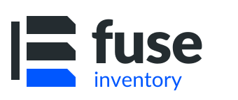

<a href="https://fuse-inventory.dev/">
  <picture>
    <source media="(prefers-color-scheme: dark)" srcset="UI/Fuse.Web/public/brand/fuse-inventory-logo-reverse.svg">
    <source media="(prefers-color-scheme: light)" srcset="UI/Fuse.Web/public/brand/fuse-inventory-logo-colour.svg">
    
  </picture>
</a>

# Fuse Inventory

[](https://github.com/lazerduck/fuse-inventory/actions/workflows/ci.yml)
[](https://github.com/lazerduck/fuse-inventory/pkgs/container/fuse-inventory)

[Website](https://fuse-inventory.dev/) · [Features](https://fuse-inventory.dev/features) · [Screenshots](https://fuse-inventory.dev/screenshots) · [Support & licensing](https://fuse-inventory.dev/licensing)

**Fuse Inventory** is a self-hosted application inventory and environment tracker designed for teams that want visibility without overhead.
It helps you describe what you have deployed, where it is deployed, and what dependencies, permissions, and accounts each system needs.

Part of [Fuse Industries](https://fuse-industries.dev/), a family of software and hardware projects built around your control. Explore our sibling project, [Fuse Vault](https://fuse-vault.dev/), a dedicated security device currently in development.

---

## ✨ Overview

Fuse Inventory lets development and DevOps teams:

* Map applications, environments, and platforms (servers, clusters, ACA, etc.)
* Record dependencies, databases, and accounts with linked grants and roles
* Capture how systems actually work — not just where they run
* Import/export everything as simple YAML or JSON
* Visualise applications and dependencies in a graph view with highlightable nodes
* Explore the blast radius of a change across connected systems
* Track risks, responsibilities, and documentation completeness
* Browse inventory in read-only documentation mode
* Track changes with comprehensive audits
* Detect account and permissions drift with SQL integration
* Optionally resolve account drift by creating accounts and applying permissions

Fuse Inventory can also integrate with:

* **Uptime-Kuma** to display health information
* **Azure Key Vault** so you can assign, create, update, and view secrets based on your permissions
* **Azure App Configuration** to explore configuration alongside your inventory

Fuse Inventory treats applications as first-class objects, with environments, dependencies, and infrastructure supporting them.

It aims to bridge the gap between documentation, DevOps, and runtime state — keeping human knowledge aligned with live systems.

---
## Screenshots

See the [screenshot gallery on the Fuse Inventory website](https://fuse-inventory.dev/screenshots) for a tour of the interface and features.

---

## 🧠 Philosophy

Fuse Inventory is built to enable you to work the way *you* want.
It doesn’t enforce “best practices” or block actions — even if they might be risky.

Plain-text secret references are intended for URLs or pointers to secrets stored elsewhere, but Fuse won’t stop you from storing whatever you choose.

Similarly, if you configure full Azure Key Vault integration (read/create/update), you are responsible for securing the container and its volume, because the Key Vault client secret must be stored locally.

---

## 🚀 Quick Start

### 🐳 Using Docker (Recommended)

Pull and run the latest image from GitHub Container Registry:

```bash
# Pull the latest image
docker pull ghcr.io/lazerduck/fuse-inventory:latest

# Run the container with a persistent data volume
docker run -d \
  --name fuse-inventory \
  -p 8080:8080 \
  -v $(pwd)/data:/app/data \
  ghcr.io/lazerduck/fuse-inventory:latest
```

The application will be available at:
**[http://localhost:8080](http://localhost:8080)**

---

### 📦 Using Docker Compose with demo data

The included `docker-compose.yml` builds the application from source and mounts `test-data/` as its persistent data directory. From a checkout of this repository, run:

```bash
docker compose up -d --build
```

Open **[http://localhost:8080](http://localhost:8080)** and sign in with the demo account:

- **Username**: Admin
- **Password**: Password

The demo environment includes sample configurations for accounts, applications, environments, datastores, and more. Changes made in the app are saved back into `test-data/`. For a fresh inventory, use the Docker command above with a separate data directory.

---

## 🔐 Security

Fuse runs entirely inside your environment — so you are responsible for securing the host, container, and data volume.

When given secrets or integration keys, Fuse stores them **on disk** so the system can use them when needed.
(No local encryption is performed; encrypting locally would still require storing a reversible key on disk.)

Fuse includes built-in authentication via JWT-based login:

* **Open mode** — anyone can view and edit
* **Read-only mode** — only admins can make changes
* **Locked-down mode** — login required to view anything

Some privileged actions (such as retrieving values from Azure Key Vault) **always** require admin access.

---

## 🧬 Core Model

Fuse Inventory’s model reflects how real systems are structured:

* **Environments** — top-level groupings (e.g., `dev`, `test`, `live`)
* **Applications** — codebases or hosted products
* **Instances** — an application deployed into an environment, with URLs and dependencies
* **Dependencies** — links to other applications, datastores, or external services
* **Accounts** — credentials associated with dependencies (API keys, SQL users, etc.)
* **Datastores** — SQL, Redis, RabbitMQ, etc., scoped to an environment
* **External Resources** — third-party services (payment providers, email platforms, etc.)
* **Platforms** — optional; servers or container platforms an instance runs on
* **Tags** — flexible labels that can be applied to almost anything

---

## 🛠️ Tech Stack

Fuse Inventory is built with:

* **.NET 10** for the API
* **Vue 3 + Quasar** for the UI
* In-memory data model with write-back to disk as JSON files
* **LiteDB** for audit storage
* Single-container deployment with persistent data volume

---

## 🧪 Test Commands

Use test categories to split fast unit tests from Docker-backed integration tests.

```bash
# Fast unit tests (excludes integration tests that need Docker)
dotnet test API/Fuse.Tests/Fuse.Tests.csproj --filter "Category!=Integration"

# Integration tests only (requires Docker)
dotnet test API/Fuse.Tests/Fuse.Tests.csproj --filter "Category=Integration"
```

Integration tests currently include API auth middleware end-to-end tests and SQL inspector tests that run against Testcontainers SQL Server.

---

## 📌 Current Status

Fuse Inventory is under active development, but the core data model is stable and backward-compatible across minor versions.

---

## 🛣️ Roadmap

* Additional Azure Key Vault tooling
* Usability improvements and guided setup flows

Check out the [Project Board](https://github.com/lazerduck/fuse-inventory/projects?query=is%3Aopen).

